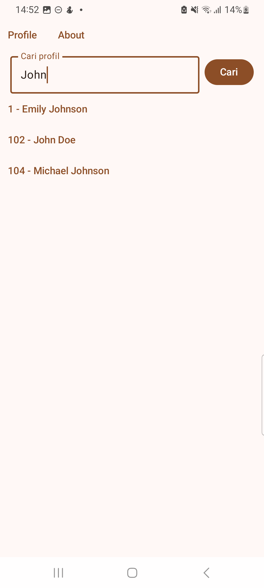

# Implementasi pencarian profil — Modul Praktikum 07

Pencarian menggunakan endpoint `GET https://dummyjson.com/users/search?q=John`.
`StudentApiService.searchUsers` menerima parameter `q` dan mengembalikan
`Call<UserResponse>`. Remote data source mengubah respons menjadi `Result`, lalu
repository memetakan `UserDto` menjadi `Student`. HomeViewModel mengatur state;
HomeScreen hanya menerima state dan callback tanpa mengakses Retrofit.

Kolom pencarian menyimpan teks pada `HomeUiState.searchQuery`. Mengetik tidak
mengirim permintaan. Tombol **Cari** mengirim query yang sudah di-trim; query kosong
memuat kembali daftar awal melalui `getStudents`. Proses ini menggunakan indikator
loading dan pesan error. **Coba Lagi** mengulang permintaan terakhir yang dikirim.
Respons lama diabaikan bila sudah ada permintaan lebih baru. Hasil kosong
menampilkan pesan bahwa profil tidak ditemukan.

## Hasil pengujian

- Build APK debug berhasil dengan `:app:assembleDebug`.
- Tiga unit test pencarian lulus: mengetik tanpa request dan query kosong;
  error beserta retry; serta respons lama yang datang setelah hasil terbaru.
- Pengujian pada perangkat Android: pencarian `John` menampilkan Emily Johnson
  (ID 1), John Doe (ID 102), dan Michael Johnson (ID 104).
- Klik John Doe membuka Detail dengan ID 102, nama John Doe, universitas Brown
  University, dan email `john.doe@x.dummyjson.com`.
- Pada percobaan awal, perangkat sempat mengalami error DNS. Aplikasi menampilkan
  pesan error dan tombol Coba Lagi. Setelah koneksi pulih, pencarian berhasil.

## Screenshot hasil pencarian

Gambar 1. Query `John` menampilkan tiga profil dari API. Pemilihan hasil menggunakan
ID profil untuk membuka halaman Detail.
